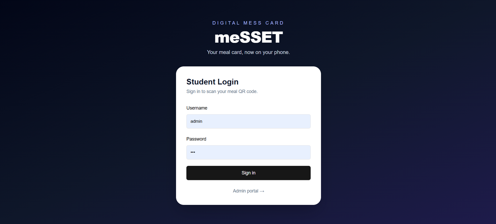
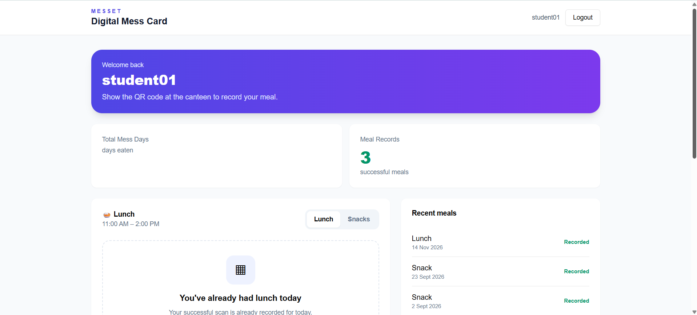
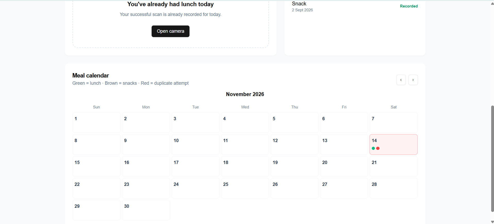
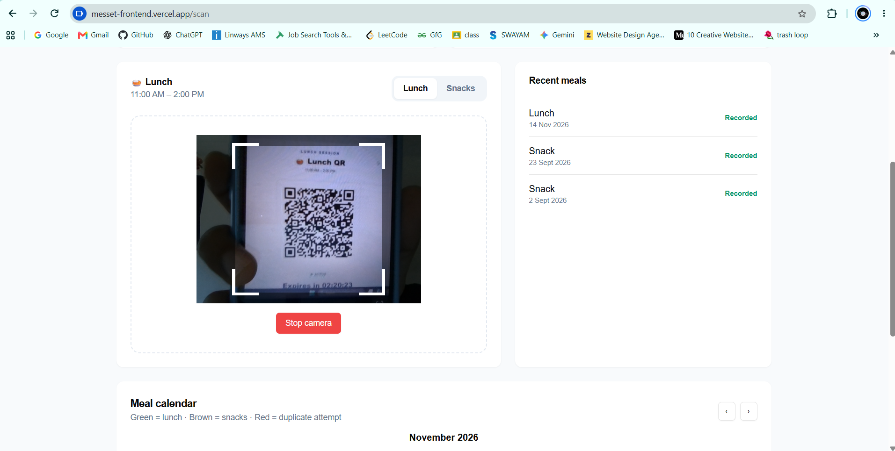
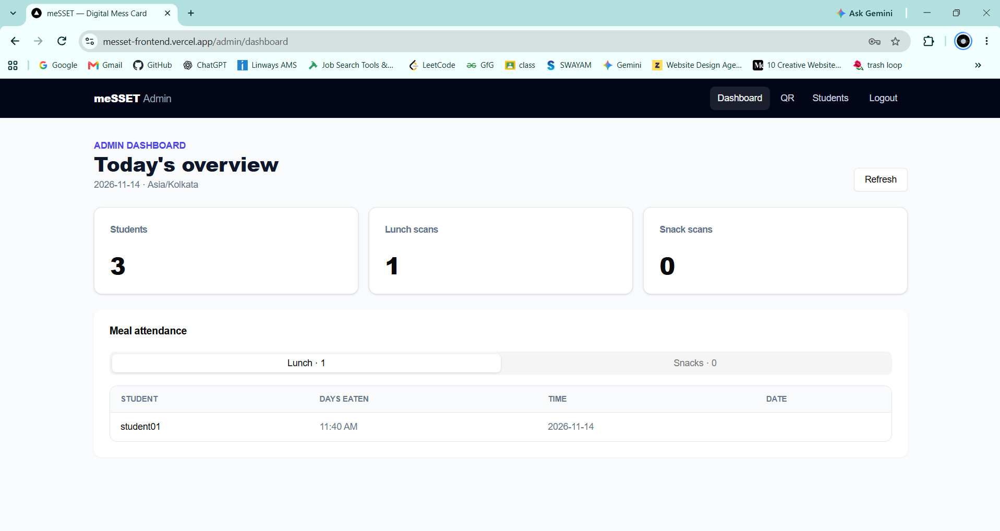
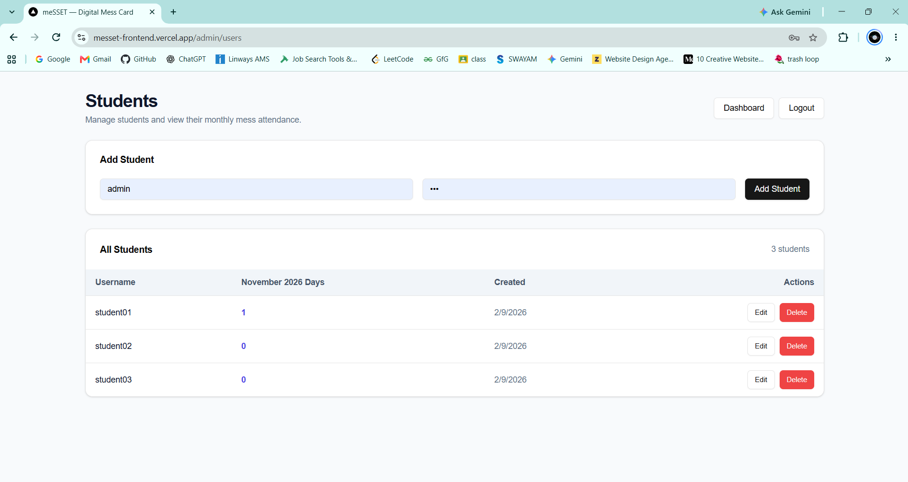

# meSSET 🎯

## Basic Details

### Team Name: NOX

### Team Members
- Member 1: Anagha TR - SCMS School of Engineering and Technology
- Member 2: Anaya Wilson - SCMS School of Engineering and Technology
- Member 3: Aneeja J - SCMS School of Engineering and Technology

### Hosted Project Link
- **Frontend:** Vercel — https://messet-frontend.vercel.app/
- **Backend:** Render — https://messet-backend.onrender.com/

### Project Description

meSSET is a Digital Mess Card System designed to simplify and automate meal attendance management in hostels and cafeterias. It replaces traditional physical mess cards with a secure digital platform that uses QR code scanning to record student meal consumption.

The application provides separate interfaces for students and administrators. Students can log in, select their meal session (Lunch or Snacks), scan the QR code displayed at the canteen, and view their meal history through a calendar interface. The system validates scans based on predefined time slots and prevents duplicate meal entries.

Administrators can manage student accounts, generate canteen QR codes, and monitor attendance through a dashboard. With real-time attendance tracking, secure authentication, and automated validation, meSSET makes mess management more convenient, efficient, and reliable.

### The Problem Statement

In hostels, students are traditionally provided with physical mess cards to access meals. These cards serve as proof of their eligibility to use mess facilities. However, relying on physical cards creates several problems:

1. **Frequent Loss of Cards:** Students often misplace their mess cards, requiring replacements.
2. **Additional Costs:** Students incur extra expenses whenever cards are lost or damaged.
3. **Inconvenience:** Carrying and maintaining a physical card can be cumbersome.
4. **Manual Verification:** Mess staff must manually check cards, making the process time-consuming and prone to errors.
5. **Attendance Management:** Maintaining and tracking meal attendance manually can be difficult and inefficient.

### The Solution

meSSET provides a modern digital alternative to traditional physical mess cards. It offers a secure, convenient, and efficient platform for students to access mess facilities using QR code-based verification.

The system automates meal attendance recording, prevents duplicate scans, and provides administrators with tools to manage students and monitor attendance.

**Key Features**

1. **Secure Login and Authentication**
   - Separate login interfaces for students and administrators.
   - JWT-based authentication and role-based access control.
   - Only registered users can access the system.
   - Protected student and administrator routes.

2. **Student Dashboard**
   - Separate options for Lunch and Snacks.
   - Interactive meal cards that provide access to QR scanning.
   - Display of meal information and attendance history.

3. **QR Code Scanner**
   - Students scan the canteen QR code using their device camera.
   - Lunch: 11:00 AM to 2:00 PM.
   - Snacks: 3:30 PM to 5:00 PM.
   - Time-window validation is enforced on the backend.
   - Only one successful scan per student per meal per day is allowed.
   - Duplicate scan attempts trigger an audio alert.

4. **Meal History and Calendar**
   - Displays the student's meal attendance history.
   - Successful scans are reflected in the calendar.
   - Duplicate attempts are retained separately so they can be identified without granting another meal.
   - Helps students keep track of their meal attendance.

5. **Admin Dashboard**
   - Provides an overview of mess attendance.
   - Allows administrators to monitor student meal activity.
   - Displays attendance information for effective management.

6. **Student Management**
   - Administrators can create, edit, and delete student accounts.
   - View student details and their meal attendance statistics.
   - Track the number of days each student has used the mess.

7. **QR Code Generation**
   - Administrators can generate and download canteen QR codes.
   - Separate QR sessions are maintained for Lunch and Snacks.
   - QR sessions are validated by the backend.

8. **Logout**
   - Students and administrators can securely log out of their respective accounts.

### How It Works

1. **Login:**
   - Students log in using their registered credentials.
   - Administrators use a separate admin login.
   - Unregistered users cannot access the system.

2. **Student Dashboard:**
   - After successful login, students are redirected to their dashboard.
   - They can choose between Lunch and Snacks.

3. **QR Code Scanning:**
   - Students scan the canteen QR code during the scheduled meal session.
   - The system validates the QR code, meal session, and time window.
   - Duplicate scans are detected and an audio alert is played.

   

4. **Attendance Recording:**
   - Once a scan is successful, the attendance record is stored in the database.
   - The system prevents multiple successful entries for the same meal and day.

5. **Calendar Updates:**
   - Students can view their meal attendance through the calendar.
   - Successful and duplicate scan attempts are represented using different visual indicators.

6. **Admin Management:**
   - Administrators can generate QR codes, manage student accounts, and monitor attendance through the admin dashboard.

7. **Profile and Logout:**
   - Students can view their profile and meal history.
   - Both students and administrators can securely log out.

---

## Technical Details

### Technologies/Components Used

**For Software:**

- **Frontend:** Next.js 15, React.js
- **Backend:** Node.js, Express.js
- **Database:** MongoDB / MongoDB Atlas
- **Authentication:** JSON Web Tokens (JWT), bcrypt
- **QR Code Scanning:** html5-qrcode

**Libraries and Packages:**
- bcryptjs
- cors
- dotenv
- express
- jsonwebtoken
- mongoose
- html5-qrcode

**Development Tools:**
- Visual Studio Code
- Git and GitHub
- MongoDB Atlas
- Vercel
- Render

### Implementation

**For Software:**

**Installation**

Clone the repository:

```bash
git clone https://github.com/Aneeja55/Team_Nox.git
```

Install backend dependencies:

```bash
cd Backend
npm install
```

Install frontend dependencies:

```bash
cd frontend2
npm install
```

**Run**

Start the backend:

```bash
cd Backend
npm run dev
```

Start the frontend in a separate terminal:

```bash
cd frontend2
npm run dev
```

The application runs locally with the frontend and backend communicating through the configured API URL.

### Project Documentation

**For Software:**

#### Screenshots (Add at least 3)



**Login Page**

The login interface allows registered students to securely access the digital mess card system.





**Lunch/Snacks - Student Dashboard**

The student dashboard provides access to the available meal sessions, Lunch and Snacks. Students can select their preferred meal session and proceed to scan the canteen QR code. It also provides an easy way to access their meal attendance and history.



**QR Code Scanner**

The scanner validates QR codes and checks whether the student has already recorded attendance for the selected meal.



**Admin Dashboard**

The admin dashboard provides an overview of mess attendance and student activity. Administrators can monitor meal attendance, view relevant statistics, and keep track of the overall usage of the mess through a centralized interface.



**Student Management**

The student management section allows administrators to manage registered student accounts. They can add new students, edit existing student details, and delete accounts when required. Administrators can also view individual student attendance statistics, including the number of days they have used the mess.

#### Diagrams


#### Build Photos


### Project Demo

#### Video

https://drive.google.com/drive/folders/1wFapt07b-orFGPWAYXm6d8hmbS8-B_-X?usp=drive_link

Demonstrates the QR code scanning process and how attendance is recorded.

#### Additional Demos

https://www.figma.com/design/YlndODZ7JhRPBQn1pCNeLw/Untitled?node-id=0-1&m=dev&t=H5hhkkWYD3v2RHrW-1

This is the initial design prototype that inspired the project. The current implementation has been developed further with additional features and a deployed backend.

## Team Contributions

- **Aneeja J:** Backend development using Node.js, Express.js, MongoDB integration, authentication, QR validation, and deployment.
- **Anagha TR:** Frontend development using Next.js and React.js.
- **Anaya Wilson:** Frontend development using Next.js and React.js.

---

Made with ❤️ at TinkerHub
